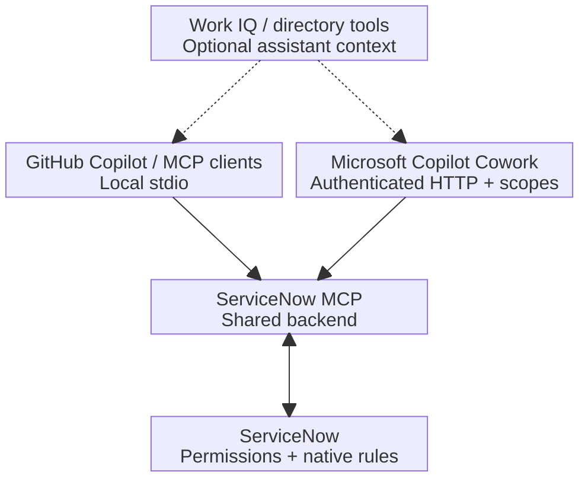

# ServiceNow MCP

Connect your AI assistant to ServiceNow to find and update incidents, manage
users and knowledge records, and make draft theme changes. Ask in natural
language, and get results with links back to the original records.

Works with the GitHub Copilot app, Microsoft Copilot Cowork and other MCP
clients. Available actions depend on the client and configured connection.

## Get started

For the GitHub Copilot plugin, you need Node.js 24+, PowerShell 7 and an existing
protected ServiceNow credential provider. Installation adds tools and skills;
the one-time connection setup connects them to your account.

Follow [Connect to ServiceNow](docs/SETUP.md) for the complete plugin setup or
the direct stdio path for clients with protected environment configuration.
For Cowork, an administrator must supply a matching OAuth connector and
[host the authenticated backend](docs/COWORK.md).

The plugin registers its MCP server as **ServiceNow**. Updating from 1.x changes
the server identifier while retaining the plugin identity and saved connection.
Follow the [update steps](docs/SETUP.md#update-an-installed-plugin) to review any
new server approvals and verify the name on an actual tool invocation.

## Try it

Start with a lookup, then ask for the change you need:

- “Find recent ServiceNow incidents about VPN.”
- “Find the ServiceNow user Morgan Lee.”
- “Assign INC0012345 to Morgan Lee.”

The incident number and person are illustrative; replace them with your own.

## Architecture

API calls and readback use the configured ServiceNow account; the assistant
composes the workflow.
Write guards include schema, policy and version checks. The operation journal
supports read-only recovery.

## Documentation

- [Supported operations](docs/CAPABILITIES.md): available tasks, tools and limits.
- [Documentation index](docs/README.md): operator policies, recovery and development.

## Credits and license

The original read-only adapter is based on
[fizamusthafa/servicenow-cowork-plugin](https://github.com/fizamusthafa/servicenow-cowork-plugin).
Maintained by Lior Kamrat. [MIT license](LICENSE); see [NOTICE](NOTICE) for attribution.
