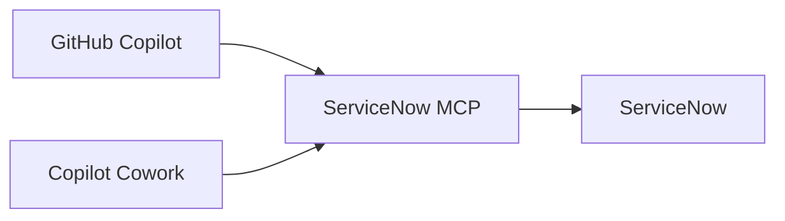

# ServiceNow MCP

ServiceNow MCP connects AI assistants to ServiceNow for incident and knowledge
management, account administration, and draft theme changes. It includes a
GitHub Copilot app plugin, two operator skills, and an authenticated HTTP
interface for Microsoft Copilot Cowork over the same backend.

## Included skills

- [Operations](skills/servicenow-operations/SKILL.md): work with records, users, groups and roles.
- [Themes](skills/servicenow-themes/SKILL.md): plan and perform reversible color and logo changes.

## MCP tools

| Area | Operations |
|---|---|
| Records | Discover schemas; query, read, create, update and delete incidents, knowledge bases and articles. |
| Users | Read profiles, create disabled accounts, update profiles, activate, lock, unlock, and assess or delete users. |
| Access | Create managed nonprivileged groups and roles; update descriptions and direct assignments. |
| Themes | Edit and restore draft primary colors and corner radius; import, apply and remove PNG-logo links. |
| Incident and change lookup | Search recent incidents and changes, or read a ticket by number. |
| Cowork incident management | Create, update and delete incidents; resolve exact assignees and assign, reassign or clear ownership. |

Account lifecycle, access changes and new PNG imports require reviewed source
policies. ServiceNow permissions still apply to every operation. See the
[tool reference](CAPABILITIES.md) for tool names, prerequisites and limits.

## How it works

AI clients send tool requests to ServiceNow MCP, which calls the ServiceNow API.



GitHub Copilot uses the stdio interface for records and administration.
[ServiceNow for Cowork](https://github.com/likamrat/servicenow-cowork-plugin)
uses a restricted authenticated HTTP interface: four incident/change lookup
tools and six incident schema, identity, CRUD and operation-status tools.
Both clients use the same record guards and private operation journal; Cowork
does not expose account, access or theme administration.

## Get started

In the **GitHub Copilot app**:

1. Open **Add** > **Manage marketplaces** and register `https://github.com/likamrat/servicenow-mcp`.
2. Open **Add** > **Plugin**.
3. Enter `servicenow-mcp@servicenow-community`, then select **Install**.
4. Follow [SETUP.md](SETUP.md#github-copilot-app) to configure the connection and make a read-only request.

Marketplace installation adds the plugin; it does not configure ServiceNow
access. Local-server requirements and connection setup are in [SETUP.md](SETUP.md).

For other clients, use the [stdio setup](SETUP.md#other-mcp-clients).
For Microsoft Copilot Cowork, use the [authenticated HTTP setup](SETUP.md#cowork-authenticated-server).

**HTTP access:** Cowork requires a configured Entra delegated resource scope and
OAuth client registration; installing either plugin does not establish that
connection. It uses the configured ServiceNow account, not per-requester
ServiceNow credentials. The legacy four-read endpoint remains loopback-only
guidance and is not an authenticated Cowork fallback. Incident/change searches
return up to 20 records updated within the last six months; incident search
matches literal title text.

## Agent installation prompt

Paste into your coding agent from this checkout:

```text
Follow SETUP.md to connect ServiceNow MCP to my chosen client.
Check the prerequisites and use my existing credential setup; do not enroll
credentials or put secrets in repository files or command arguments.
For the GitHub Copilot app, configure the documented nonsecret provider binding.
For Cowork, use the authenticated restricted incident interface and explain
the required resource scope, OAuth client registration and source permissions.
Start with writes disabled; do not expose the legacy anonymous interface.
Ask before installation, access changes or ServiceNow writes.
Verify the connection with a read-only request from the chosen client.
Report missing prerequisites and connection errors. Do not push or publish.
```

## Development

With Node.js 24+ and PowerShell 7:

```sh
npm ci --ignore-scripts
npm run check
npm test
npm run notices:check
```

The tests use synthetic sources; no ServiceNow credentials are needed.

## Credits and license

The read-only adapter builds on
[ServiceNow for Cowork](https://github.com/likamrat/servicenow-cowork-plugin),
originally created by [fizamusthafa](https://github.com/fizamusthafa/servicenow-cowork-plugin).
Maintained by Lior Kamrat.

MIT; see [LICENSE](LICENSE) and [NOTICE](NOTICE).
[Source provenance](PROVENANCE.md) and
[third-party licenses](THIRD_PARTY_NOTICES.txt) are documented separately.
