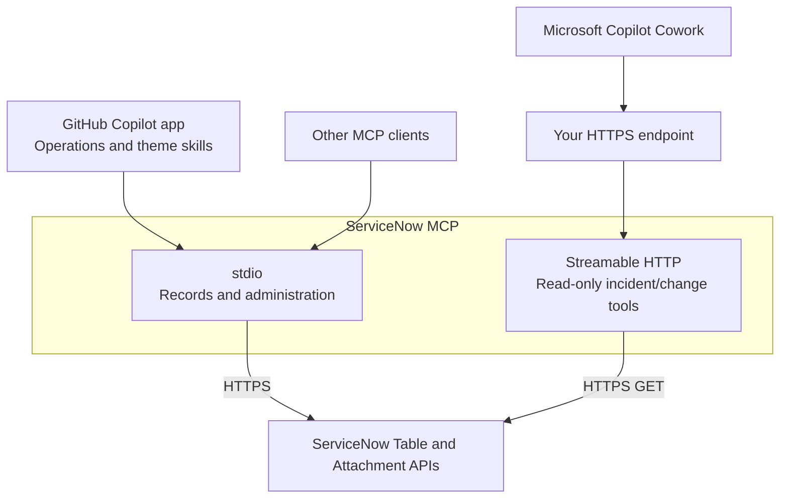

# ServiceNow MCP

ServiceNow MCP connects AI assistants to ServiceNow for incident and knowledge
management, account administration, and draft theme changes. It includes a
GitHub Copilot app plugin, two operator skills, and a separate read-only HTTP
interface for Microsoft Copilot Cowork.

## Included skills

- [Operations](skills/servicenow-operations/SKILL.md): work with records, users, groups and roles.
- [Themes](skills/servicenow-themes/SKILL.md): plan and perform reversible color and logo changes.

## MCP tools

| Area | Operations |
|---|---|
| Records | Discover schemas; query, read, create, update and delete incidents, knowledge bases and articles. |
| Users | Read profiles, create disabled accounts, update profiles, activate, lock, unlock, and assess or delete users. |
| Access | Create managed nonprivileged groups and roles; update descriptions and direct assignments. |
| Themes | Edit and restore draft primary colors and corner radius; import, apply and remove PNG-logo links. |
| Incident and change lookup | Search recent incidents and changes, or read a ticket by number. |

Account lifecycle, access changes and new PNG imports require reviewed source
policies. ServiceNow permissions still apply to every operation. See the
[tool reference](CAPABILITIES.md) for tool names, prerequisites and limits.

## Architecture

The stdio interface provides record and administrative tools. The HTTP
interface exposes only `search_incidents`, `get_incident`, `search_changes`
and `get_change`.



The [ServiceNow for Cowork](https://github.com/likamrat/servicenow-cowork-plugin)
repository contains the Cowork client package and its incident/change skills.
This repository owns the shared server.

## Get started

For the **GitHub Copilot app**, use Node.js 24+, PowerShell 7 and a
[credential-manager adapter](SETUP.md#credential-provider).

1. Open **Add** > **Manage marketplaces** and register `https://github.com/likamrat/servicenow-mcp`.
2. Open **Add** > **Plugin**.
3. Enter `servicenow-mcp@servicenow-community`, then select **Install**.
4. Follow [SETUP.md](SETUP.md#github-copilot-app) to configure the connection and make a read-only request.

For other clients, use the [stdio setup](SETUP.md#other-mcp-clients).
For Microsoft Copilot Cowork, use the [read-only HTTP setup](SETUP.md#cowork-read-only-server).

**HTTP access:** the read-only server has no client authentication. Anyone who
can reach it can read through its configured ServiceNow account. Keep it on
loopback unless external access is deliberately restricted. Incident/change
searches return up to 20 records updated within the last six months; incident
search matches literal title text.

## Agent installation prompt

Paste into your coding agent from this checkout:

```text
Follow SETUP.md to connect ServiceNow MCP to my chosen client.
Check the prerequisites and use my existing credential setup; do not enroll
credentials or put secrets in repository files or command arguments.
For the GitHub Copilot app, configure the documented nonsecret provider binding.
Keep the Cowork HTTP interface read-only and explain its access restrictions.
Ask before installation, access changes or ServiceNow writes.
Verify the connection with a read-only request from the chosen client.
Report missing prerequisites and connection errors. Do not push or publish.
```

## Development

With Node.js 24+ and PowerShell 7:

```sh
npm ci --ignore-scripts
npm run check
npm test
npm run notices:check
```

The tests use synthetic sources; no ServiceNow credentials are needed.

## Credits and license

The read-only adapter builds on
[ServiceNow for Cowork](https://github.com/likamrat/servicenow-cowork-plugin),
originally created by [fizamusthafa](https://github.com/fizamusthafa/servicenow-cowork-plugin).
Maintained by Lior Kamrat.

MIT; see [LICENSE](LICENSE) and [NOTICE](NOTICE).
[Source provenance](PROVENANCE.md) and
[third-party licenses](THIRD_PARTY_NOTICES.txt) are documented separately.
